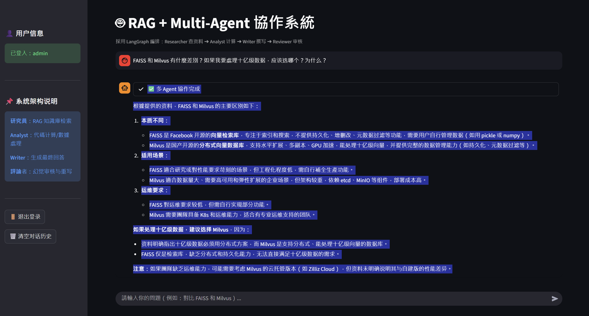

shiyueyirag
一个基于 向量数据库（Milvus）+ RAG + LangGraph 多 Agent 协作 的智能问答与研报生成系统。包含文档解析、混合检索、重排序、多 Agent 编排、微调数据工程与服务化部署的全链路落地。

核心架构升级：采用中心化编排（Orchestrator-Worker）架构，由主控状态机调度 Researcher、Analyst、Writer、Reviewer 四个辅助 Agent，实现检索、计算、生成、审核闭环。

https://img.shields.io/badge/python-3.10+-blue
https://img.shields.io/badge/license-MIT-green
https://img.shields.io/badge/docker-compose-blue

架构设计
本项目采用了 中心化编排（Orchestrator-Worker）架构，基于 LangGraph 的状态图（StateGraph）作为主控中心，调度四个专职 Agent：

[用户请求]
|
v
【主控中心 (StateGraph)】
(维护全局 AgentState 并调度)
|
+---------------+---------------+---------------+
| | | |
v v v |
[Researcher] [Analyst] [Writer] <----------+
(RAG 知识检索) (AST 数学计算) (结构化生成) |
| | | |
+---------------+---------------+---------------+
|
v
[Reviewer] -------------------------+
(防幻觉审核) -- (若发现幻觉，打回重写)
|
v
[最终输出]

Researcher：封装 RAG 链路，负责从 Milvus 中精准召回文档片段。
Analyst：内置安全的 AST 解析器，负责处理数值计算与数据对比。
Writer：纯文本生成节点，只接收上游提炼后的精简信息，降低上下文污染。
Reviewer：负责核验草稿是否超出检索资料，若发现幻觉自动打回给 Writer 重写（引入 revision_count 防死循环）。

功能特性
文档入库：解析 PDF / DOCX / Markdown，切分后向量化存入 Milvus (HNSW 索引)

混合检索：手写 BM25 + 向量语义的双路召回，并接入 BGE Reranker 重排

多 Agent 协作：基于 LangGraph 实现检索、计算、撰写、审核的状态机流转

API 服务：FastAPI 提供 HTTP 接口，支持 Pydantic 数据校验

监控看板：Streamlit 实现多 Agent 执行轨迹的实时可视化

全链路可观测：基于 JSONL 的结构化日志记录器，便于排障与数据回流

微调数据合成：基于 GLM 构建意图矩阵，自动扩充并去重客服微调数据

检索效果评估 (消融实验)
基于 20 个真实业务问题构建黄金测试集，对比不同检索策略：

检索策略 Recall@1 Recall@3 Recall@5

纯向量检索 50.00% 100.00% 100.00%
混合检索 (alpha=0.5) 100.00% 100.00% 100.00%
混合检索 (alpha=0.7) 77.78% 100.00% 100.00%
混合检索 + BGE Reranker 100.00% 100.00% 100.00%

实验结论：

纯向量检索的短板：Recall@1 仅 50%，说明在包含“FAISS、Milvus、pgvector”等专有名词密集的技术文档中，纯语义向量检索容易因“语义泛化”将相似概念混淆，导致正确块无法排在第一位。

BM25 混合检索的优势：引入 BM25（alpha=0.5）后，Recall@1 从 50% 飙升至 100%。说明关键词精准匹配有效弥补了向量检索在专有名词上的缺陷。

权重敏感度测试：当 alpha 提升至 0.7 和 0.9 时，由于向量权重过大，稀释了 BM25 的精准度，导致 Recall@1 回落（77.8% 和 50%）。

重排序（Reranker）的保底作用：在粗排权重波动（alpha=0.7）导致 Recall@1 下降时，接入 bge-reranker 对 Top-10 结果进行精排，成功将 Recall@1 再次拉回 100%。这证明了在工程实践中，“粗排决定下限，精排决定上限”的检索架构原则。

项目结构
core/ # 核心算法与引擎
rag.py # RAG 核心：Milvus(HNSW) + BM25 + Reranker
jiexi.py # 多格式文档解析 (pymupdf4llm / docling)
metrics.py # 检索评测指标 (Recall / Hit Rate / MRR)
logger.py # 基于 JSONL 的结构化日志记录器

agents/ # 智能体编排
multi_agent.py # LangGraph 多 Agent 状态机核心
main.py # 基础大模型 Client 与 Tool 执行器
tools.py # 基于装饰器的工具注册中心

evals/ # 评测与测试
eval.py # RAG 黄金测试集评测
eval_agent.py # 多 Agent 端到端行为评测
eval_main.py # 消融实验评测脚本
wendang.py # 自动生成包含表格/标题的测试 PDF 和 Word

data_engineering/ # 数据与微调工程
generate_data.py # 基于 GLM 的客服意图数据合成脚本
view_log.py # 日志解析与 Trace 可视化工具

deployment/ # 服务化与前端
api.py # FastAPI 接口服务
demo.py # Streamlit 多 Agent 监控看板
docker-compose.yml # Milvus / etcd / MinIO 编排

README.md
requirements.txt

环境要求
Python 3.10+

Docker & Docker Compose（用于 Milvus）

智谱 API Key

快速开始
克隆项目
git clone https://github.com/31354/shiyueyirag.git
cd shiyueyirag

安装依赖
pip install -r requirements.txt

启动 Milvus 向量数据库
确保本地已安装并启动了 Docker Desktop，然后执行：
docker compose -f deployment/docker-compose.yml up -d
启动后可访问 Milvus: localhost:19530

配置环境变量
在终端中设置你的智谱 API Key：
Windows (PowerShell): $env:ZHIPU_API_KEY="your_key_here"
Linux / Mac: export ZHIPU_API_KEY="your_key_here"

运行应用
启动多 Agent 可视化看板：
streamlit run deployment/demo.py

启动 FastAPI 后端服务：
uvicorn deployment.api:app --reload --port 8000
API 启动后访问 http://localhost:8000/docs 查看接口文档。

配置说明
必填项
ZHIPU_API_KEY：智谱 API Key

RAG 检索配置
TOP_K：检索返回的文档条数，默认 5
SCORE_THRESHOLD：相似度阈值，低于此值触发拒答，默认 0.6
CHUNK_SIZE：文档分块大小（字符数），默认 500
CHUNK_OVERLAP：分块重叠字符数，默认 50

Agent 配置
MAX_STEPS：单 Agent 最大循环步数，默认 5
MAX_RETRIES：多 Agent 架构中 Reviewer 打回重写的最大次数，默认 2

评测脚本使用
项目内置三套评估脚本：

检索质量评估 (黄金测试集)
python evals/eval.py

消融实验评估
python evals/eval_main.py
对比纯向量、不同 alpha 权重的混合检索、以及重排效果。

Agent 端到端评估
python evals/eval_agent.py
测试 Agent 的文档问答、数学计算、拒答与工具调用能力。当前结果：通过 6/6。

常见问题 (FAQ)
Q1: eval.py 的 Recall@1 全是 0，是检索坏了吗？
先别急着怀疑检索。最常见的原因是评测集里的 true_indices 标错了。如果标注的 id 和实际 chunk 内容对不上，检索再准也会被判为 0。

Q2: 为什么 Rerank 后 Recall@3 反而下降了？
小样本评测波动大。Rerank 模型对中文支持有限时可能把正确答案排后。建议扩大测试集到 20 条以上，并确保使用 bge-reranker-v2-m3 等中文效果好的模型。

Q3: 改了文档，为什么检索结果没变？
eval.py 启动时会检查 Milvus 中是否已有数据，如果已有块会跳过 embedding。解决方法是清空 Milvus 数据卷后重新入库：
docker compose down
docker volume rm <milvus数据卷名>
docker compose up -d

Q4: 评测集多大才可信？
一般建议至少 20–30 条。4 条以下波动极大，Recall@1 只能在 0、0.25、0.5、0.75、1.0 几档之间跳，不具备参考价值。

Q5: Recall@1 对多答案问题为什么算不准？
当一个问题对应多个 chunk（如 FAISS 和 Milvus 有什么区别？ 对应 chunk[3] 和 chunk[5]），Top-1 只能命中一个，按命中比例算，R@1 最多 0.5。这是评测算法的固有局限，看 Recall@3 或 Recall@5 更合理。

Q6: 启动时提示 Failed to find CUDA 怎么办？
这是警告，不是错误。如果没有 GPU 或没装 CUDA，Rerank 模型会在 CPU 上运行，速度慢但不影响功能。

Q7: 多 Agent 系统死循环了怎么办？
在多 Agent 的 Reviewer 节点中，我引入了 revision_count 计数器。如果审核打回重写超过 2 次，主控状态机会强制跳出循环，标记为“未能完美符合要求”，防止耗尽 API 额度。

技术栈
向量数据库：Milvus + etcd + MinIO (Docker 编排)
Agent 框架：LangGraph (状态机编排)
LLM：智谱 GLM-4
Embedding：智谱 embedding-3
检索优化：BM25 (jieba) + BGE Reranker
API 框架：FastAPI + Pydantic
可视化：Streamlit
数据工程：LLaMA-Factory (LoRA)、PyMuPDF、Docling

Roadmap
[x] 支持混合检索（向量 + BM25）
[x] 支持重排序（Rerank）
[x] 升级为 LangGraph 多 Agent 架构
[x] 增加数据合成与 LoRA 微调链路
[ ] 增加更多文档格式（Excel、PPT）
[ ] 接入 Langfuse 做全链路可观测性

License
本项目采用 MIT License 授权。